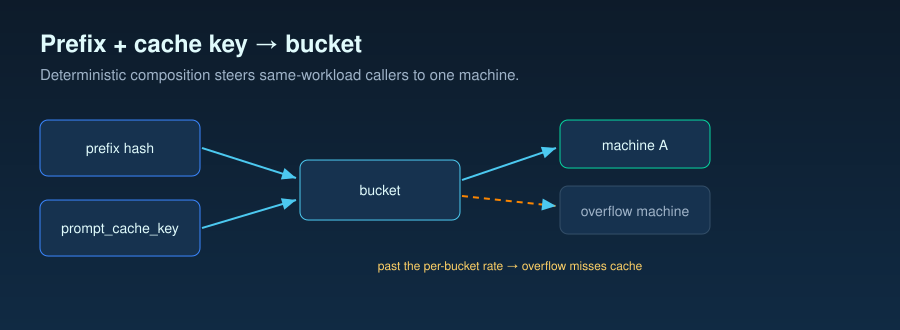

# Operator Guide — `prompt_cache_key` Policy Library



> Module: `batch_runner.cache`. Task 026.
> Scope: deterministic `prompt_cache_key` composition, bucket sizing,
> and `prompt_cache_retention` defaults for Azure OpenAI provisioned
> throughput unit (PTU) deployments. Pairs with the Task 018
> measurement benchmark (`scripts/measure_cache_key_bucketing.py`),
> the Task 022 one-pager, and Microsoft Learn, "Prompt caching with
> Azure OpenAI in Microsoft Foundry Models"
> (`prompt_cache_key` and `prompt_cache_retention`;
> https://learn.microsoft.com/en-us/azure/foundry/openai/how-to/prompt-caching,
> checked 2026-11-23).

## 1. What `prompt_cache_key` actually is

Two statements restated from Microsoft Learn, "Prompt caching with
Azure OpenAI in Microsoft Foundry Models" (2026-05-19 snapshot:
https://web.archive.org/web/20260519140800/https://learn.microsoft.com/en-us/azure/foundry/openai/how-to/prompt-caching):

1. The value is combined with the prefix hash to influence
   **routing** and improve cache hit rate.
2. When requests for the same `(prefix + cache_key)` combination
   exceed approximately **15 req/min**, some requests overflow to
   additional machines, which reduces cache effectiveness. This
   15 req/min figure is **official spec**.

A third statement is this doc's reading (operational inference), not
a Learn statement:

3. It is a **best-effort routing hint**, not a guarantee: the intent
   is to steer callers with the same workload to the same machine,
   but Learn says only that the key influences routing. The cache
   itself remains Azure-side; this library only composes the hint.

The current page
(https://learn.microsoft.com/en-us/azure/foundry/openai/how-to/prompt-caching,
checked 2026-11-23) scopes its `prompt_cache_key` advice and the
15 req/min figure to models before GPT-5.6; GPT-5.6 and later models
use explicit cache breakpoints instead.

This library does not store anything, does not predict hit rate, and
does not call out to Azure. It is a pure helper used at the call site
to construct the value the request body sends to the deployment.

## 2. Composing keys

### Function

```python
from batch_runner.cache import cache_key

key = cache_key(
    tenant="acme",
    flow="answer",
    locale="en-US",   # default
    schema="v1",      # default
    category=None,    # optional
)
# -> "acme:answer:en-US:v1"
```

All parameters are keyword-only. Identical inputs return identical
strings on every call, in every process, on every host. The
composition path imports no clock, no random source, and no UUID
module; static review can confirm this against the source tree.

### GOOD examples (workload-oriented)

| Use case | `cache_key(...)` call | Result |
|---|---|---|
| Single-tenant support agent | `cache_key(tenant="acme", flow="support_agent")` | `acme:support_agent:en-US:v1` |
| Multi-locale summarizer | `cache_key(tenant="contoso", flow="summarize", locale="ko-KR")` | `contoso:summarize:ko-KR:v1` |
| Schema-versioned QA | `cache_key(tenant="northwind", flow="qa", schema="v3")` | `northwind:qa:en-US:v3` |
| Category-routed agent | `cache_key(tenant="acme", flow="triage", category="billing")` | `acme:triage:en-US:v1:billing` |

These keys are stable across requests for the same workload, so
multiple requests land on the same `(prefix + cache_key)` bucket and
share the cached prefix.

### ANTI-PATTERN examples (per-request entropy)

Three categories of per-request entropy (UUIDs, request ids,
timestamps) explode cardinality and defeat the routing hint. Treating
them as anti-patterns is operational policy, built on the current
Learn page's advice (checked 2026-11-23, models before GPT-5.6) to
keep a stable mapping between each key and its prefixes. The
`assert_deterministic` helper rejects all three:

| Anti-pattern | Why it fails | Reason code |
|---|---|---|
| UUID embedded in key | Every request gets a unique bucket | `looks_like_uuid` |
| Request id embedded in key | Same; also leaks request-scoped state | `contains_request_id_token` |
| Unix timestamp embedded in key | Bucket churns every second | `contains_long_digit_run`, `contains_timestamp_token` |
| Raw hash digest embedded in key | High-entropy hex run looks per-request | `contains_high_entropy_hex_run` |

### Guard at the call site

```python
from batch_runner.cache import assert_deterministic, anti_pattern_reasons

untrusted = build_key_from_config(...)   # caller-defined

# Hard guard — raises ValueError with reason codes only.
assert_deterministic(untrusted)

# Soft probe — returns a list of reason codes; safe to log.
for reason in anti_pattern_reasons(untrusted):
    log.warning("cache_key anti-pattern detected", reason=reason)
```

**Error policy.** When `assert_deterministic` raises, the exception
message contains only short reason codes (`looks_like_uuid`,
`contains_long_digit_run`, etc.). The offending key value is never
included in the message and is never logged by this library. Callers
that need the value for debugging must log it themselves, in their
own trusted logging context.

## 3. Sizing buckets

### Formula (operational inference)

```
common_prefix_rpm           = common_prefix_tps × 60
minimum_buckets_at_threshold = ceil(common_prefix_rpm / 15)
recommended_buckets          = ceil(common_prefix_rpm / target_rpm_per_bucket)
```

The threshold `15 req/min` is **official spec**: the 2026-05-19
snapshot of the Microsoft Learn prompt caching page (cited in
section 1) says some requests above it overflow to additional
machines, which reduces cache effectiveness. The current page
(https://learn.microsoft.com/en-us/azure/foundry/openai/how-to/prompt-caching,
checked 2026-11-23) scopes the threshold to models before GPT-5.6
only and says that above it some requests might miss the cache, so
this sizing applies to those models. The formula itself is
**operational inference** per Task 029: it turns the current page's
advice to distribute higher-volume traffic across multiple keys into
a division and a ceiling. The `target_rpm_per_bucket` default of `10`
is **operational inference** per Task 029: the midpoint of `[8, 12]`,
a working range used here. Once Task 018's
measurement closes the loop, callers should reconsider this default
against the measured curve.

### Worked example

A workload measured at **1.4 TPS (requests per second)** sharing a common prefix:

```python
from batch_runner.cache import recommended_bucket_count

r = recommended_bucket_count(common_prefix_tps=1.4)
assert r.common_prefix_rpm == 84.0
assert r.minimum_buckets_at_threshold == 6   # ceil(84 / 15)
assert r.recommended_buckets == 9            # ceil(84 / 10)
```

Operationally: split the workload across **9 cache-key buckets** so
the per-bucket steady-state rate sits comfortably below the 15 req/min
overflow point, with the 6-bucket minimum as the hard minimum.

### Result dataclass

`recommended_bucket_count(...)` returns a frozen `BucketSizingResult`
exposing the inputs and both derived counts so the calling code can
log the rationale (rather than just the answer):

```
BucketSizingResult(
    common_prefix_tps=1.4,
    common_prefix_rpm=84.0,
    target_rpm_per_bucket=10,
    threshold_rpm_per_bucket=15,
    minimum_buckets_at_threshold=6,
    recommended_buckets=9,
)
```

## 4. Retention

### Model default table

Microsoft Learn, "Prompt caching with Azure OpenAI in Microsoft
Foundry Models", section "Prompt cache retention" (2026-05-19
snapshot:
https://web.archive.org/web/20260519140800/https://learn.microsoft.com/en-us/azure/foundry/openai/how-to/prompt-caching),
lists eleven models that support `prompt_cache_retention="24h"`. The
documented default applied when the request body omits the field is
`in_memory` on every listed model:

```
gpt-5.4              gpt-5.1-codex        gpt-5
gpt-5.3-codex        gpt-5.1-codex-mini   gpt-5-codex
gpt-5.2              gpt-5.1-chat         gpt-4.1
gpt-5.1-codex-max    gpt-5.1
```

The current page (checked 2026-11-23) lists twelve models: it adds
gpt-5.5, on which extended retention is the default. The list above
and the code table stay at the snapshot's eleven.

This means cross-request reuse beyond the short in-memory window
requires the caller to **explicitly** set `prompt_cache_retention=
"24h"` in the request body. Forgetting it is the "common trap" (a
label used in this doc; operational policy).

### `ensure_explicit` enforces the choice

```python
from batch_runner.cache import ensure_explicit, ImplicitInMemoryError

try:
    retention = ensure_explicit("gpt-5.2", request.cache_retention)
except ImplicitInMemoryError:
    # The caller forgot to pass a value on a model whose documented
    # default is in_memory. Make the choice deliberate.
    raise

# retention is now one of {"in_memory", "24h"}, explicitly chosen.
request_body["prompt_cache_retention"] = retention
```

`ensure_explicit` raises `ImplicitInMemoryError` (a `ValueError`
subclass) when `retention is None` on any model whose documented
default is `in_memory`. It raises `KeyError` for models not on the
list above, and `UnknownRetentionValueError` for values outside
`{"in_memory", "24h"}`.

### Pricing parity

Microsoft Learn's prompt caching page states that prompt cache pricing
is the same for both retention policies (checked 2026-11-23): on the
listed models, extended-retention (`"24h"`) cache reads are billed at
the same per-token rate as in-memory cache reads. Choosing `"24h"` over `"in_memory"` does not change the
cached-read price; it changes the eligibility window for the discount.

## 5. Monitoring

The operational loop used here for cache-key buckets (operational
inference) tracks per-bucket requests per minute (RPM):

1. **Measure** per-bucket RPM in production (Task 028 schema events).
2. **Compare** the observed RPM to the 15 req/min threshold and the
   `target_rpm_per_bucket` headroom target.
3. **Alarm** when sustained per-bucket RPM exceeds the threshold
   (overflow likely) or when measured cache hit rate drops without a
   workload change.
4. **Resize** by re-running `recommended_bucket_count` with the new
   measured TPS, then updating the bucket dimension on the call-site
   side (this library does not own the call-site routing).

This library does not perform monitoring itself. It composes the key
and computes the target; observation is the caller's responsibility.

## 6. What this does NOT do

| Concern | Owned by |
|---|---|
| Measuring the 15 req/min threshold empirically | Task 018 — `scripts/measure_cache_key_bucketing.py` |
| Recovering from 429s after overflow | Task 023 — `batch_runner.ptu.admission_controller` |
| Coordinating cooldown across N workers | Task 025 — `batch_runner.ptu.cooldown_coordinator` |
| Predicting per-bucket hit rate from a replay | Task 024 — `batch_runner.ptu.replay_simulator` |
| Storing the cache itself | Azure-side; not the caller's concern |
| Customer-facing one-pager about the lever | Task 022 |

## 7. Compliance with Task 029 (methodology classification)

| Value | Classification | Source |
|---|---|---|
| `15 req/min` per-bucket overflow threshold | **official spec** | Microsoft Learn, "Prompt caching with Azure OpenAI in Microsoft Foundry Models" (approximately 15 requests per minute per prefix + `prompt_cache_key`, above which some requests overflow to additional machines), 2026-05-19 snapshot: https://web.archive.org/web/20260519140800/https://learn.microsoft.com/en-us/azure/foundry/openai/how-to/prompt-caching. The current page (https://learn.microsoft.com/en-us/azure/foundry/openai/how-to/prompt-caching, checked 2026-11-23) scopes it to models before GPT-5.6 only and says some requests might miss the cache |
| Sizing formula structure (`rpm / target`) | **operational inference** | Built on the current Learn page's advice (checked 2026-11-23) to distribute higher-volume traffic across multiple keys; the `rpm / target` arithmetic turns that into a bucket count |
| `target_rpm_per_bucket = 10` default | **operational inference** | Midpoint of `[8, 12]`, a working range used here; to be revisited against Task 018's measured curve |
| Retention default table | **official spec** | Microsoft Learn, "Prompt caching with Azure OpenAI in Microsoft Foundry Models", extended-retention model list and `in_memory` default, 2026-05-19 snapshot: https://web.archive.org/web/20260519140800/https://learn.microsoft.com/en-us/azure/foundry/openai/how-to/prompt-caching |
| `ensure_explicit` "must be explicit" rule | **operational policy** | Microsoft Learn documents the `in_memory` default (2026-05-19 snapshot); this library refuses to let callers rely on it silently |
| Anti-pattern reason codes | **operational policy** | Categories of per-request entropy used in this doc, built on the current Learn page's advice (checked 2026-11-23) to keep a stable mapping between each key and its prefixes |

Anywhere this library or its outputs are cited downstream, the
classification labels above MUST be preserved.
