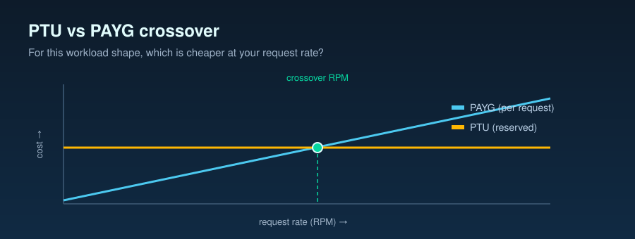

# Provisioned Throughput Unit (PTU) vs Pay-As-You-Go (PAYG) Decision Runbook



> Module: `batch_runner.sizing`. Task 027.
> Scope: single-deployment Azure OpenAI PTU sizing and PAYG crossover
> arithmetic. The density table and output weights come from
> Microsoft Learn's provisioned-throughput pages; see Pricing
> References below for URLs and access dates.

## 1. What This Runbook Answers

This runbook answers one operating question:

> For this measured workload shape, is PTU or PAYG cheaper at the
> current request rate, and how large is the PTU deployment implied by
> the Microsoft Learn Input TPM/PTU table?

The calculator returns a recommended provisioned throughput unit (PTU)
count, a pay-as-you-go (PAYG) crossover rate in requests per minute
(RPM), a decision label (`ptu_favorable`, `payg_favorable`, or
`near_crossover`), and the dominant operational driver.

## 2. What This Runbook Does Not Answer

It does not choose the model. Use `docs/04-decision-framework.md` for
reasoning-vs-standard model selection.

It does not compose `prompt_cache_key` values. Use
`docs/12-prompt-cache-key-policy.md` and `batch_runner.cache`.

It does not handle HTTP rate-limit status 429 recovery. Use `docs/10-ptu-admission-controller.md`
and `batch_runner.ptu.admission_controller`.

It does not optimize across regions, resources, negotiated discounts,
or PTU reservation contracts.

## 3. Inputs To Collect

Collect these five workload measurements before running the CLI:

1. Mean prompt tokens per request.
2. Mean cached fraction of prompt tokens, from 0.0 to 1.0.
3. Mean visible output tokens per request.
4. Mean reasoning tokens per request; use 0 for non-reasoning models.
5. Expected steady-state RPM for this deployment.

Also record `mean_max_output_tokens`, because PTU admission reserves
against that cap, not against the actual visible output.

## 4. Diagnostic Checklist

Driver list, carried into the calculator. The four-driver grouping is
the diagnostic grouping used in this runbook (operational inference).
The facts behind drivers 1, 3, and 4 are on Microsoft Learn: output-token
weighting and the 100% cached-token deduction on the provisioned
throughput onboarding page (2026-05-19 archive), and the per-request
estimate from prompt tokens less cached tokens plus `max_tokens` on
"Operate provisioned throughput deployments in production" (checked
2026-11-23).

1. `output_weighting`: output tokens carry model-specific input-token
   weight. Operational interpretation: a large `max_output_tokens`
   value is expensive on models where output is weighted 8:1 or 4:1.
2. `reasoning_accumulation`: reasoning tokens are billed as output
   tokens and counted within `max_output_tokens`. Operational
   interpretation: hidden reasoning can move the PAYG crossover even
   when the visible answer is short.
3. `cache_hit_drop`: cache hit ratio drop increases non-cached prompt
   demand. Operational interpretation: low `mean_cached_fraction`
   makes PTU and PAYG both pay more input-side cost.
4. `max_tokens_oversize`: oversized `max_output_tokens` reduces PTU
   concurrency because admission reservation uses the cap. Operational
   interpretation: if `max_output_tokens - visible_output_tokens` is
   large, right-size the cap before buying PTU.

Microsoft Learn also publishes non-uniform Input tokens per minute per
provisioned throughput unit (TPM/PTU) density by model.
The calculator reads the frozen local data file in
`pricing/ptu-density-2026-05.yaml`.

## 5. Run The Calculator

```bash
python -m scripts.ptu_sizing \
  --workload batch-runner/tests/fixtures/synthetic_workload.yaml \
  --target-util 0.7 \
  --payg-rates pricing/azure-openai-payg-2026-05.yaml \
  --ptu-rates pricing/azure-openai-ptu-2026-05.yaml
```

The output is stable JSON on stdout. The calculator performs no live
application programming interface (API) calls and reads no environment variables.

## 6. Worked Example

Synthetic workload:

```yaml
model_id: gpt-5.2
mean_prompt_tokens: 1000
mean_cached_fraction: 0.30
mean_visible_output_tokens: 200
mean_reasoning_tokens: 0
mean_max_output_tokens: 8000
expected_rpm: 60.0
```

With target utilization `0.7`, the sizing calculation uses:

```text
non_cached_prompt = 1000 - 300 = 700
admission_tokens_per_call = 700 + 8000 * 8 = 64700
demand_tpm = 64700 * 60 = 3882000
recommended_ptu_count = ceil(3882000 / 3400 / 0.7) = 1632
```

The dominant driver is `max_tokens_oversize`: the request reserves
8000 output tokens while the visible mean is only 200. In this
synthetic example, the current RPM remains far below the PAYG-vs-PTU
crossover, so the decision is `payg_favorable`.

## 7. Operational Inference Labels

The 8:1 output-weight ratio for `gpt-5` and the 4:1 ratio for
`gpt-4.1` are treated as official spec examples from Microsoft Learn
(provisioned throughput onboarding page, 2026-05-19 archive).

The 8:1 working assumption for `gpt-5.2`, `gpt-5.2-codex`,
`gpt-5.3-codex`, `gpt-5.1`, and `gpt-5.1-codex` is **operational
inference**. The YAML file labels it as `# operational inference`
and calculator rationales repeat the label.

These labels describe the 2026-05-19 archive of the onboarding page,
which is what the density file pins. Among the models in the density
file, that snapshot gives a ratio only for `gpt-5` (8) and `gpt-4.1`
(4). It gives none for these five models
or for `gpt-4o`, so the density file lists `gpt-4o` as `unspecified`
and the calculator weights its output at 1.0 and flags that in the
rationale. The current "Determine PTU sizing for a workload" page
(<https://learn.microsoft.com/en-us/azure/foundry/openai/how-to/provisioned-throughput-sizing>,
checked 2026-11-23) now lists 8 for `gpt-5.2`, `gpt-5.2-codex`,
`gpt-5.3-codex`, `gpt-5.1`, and `gpt-5.1-codex`, and 4 for `gpt-4o`.
The frozen 2026-05 density file keeps its values and labels; moving
these models to `explicit` takes a new dated density file and a
promotion note under §7 of `docs/15-spec-vs-inference-taxonomy.md`.

The `near_crossover` 5% band is operational policy. It exists so an
operator re-measures the workload instead of treating tiny list-price
differences as a procurement signal.

Task 024 leak calibration is also operational inference. If supplied,
the calculator records it in the rationale, but steady-state sizing
still uses the Microsoft Learn Input TPM/PTU table pinned in
`pricing/ptu-density-2026-05.yaml`.

## 8. Caveats

The calculator is single-region and single-deployment only.

It uses on-demand PTU rates from the explicit `pricing/` YAML. PTU
reservation discounts, enterprise agreements, and multi-resource
packing are not included.

It does not auto-fetch pricing. Create a new dated pricing file if Azure
publishes a rate or density change.

When the calculator returns `near_crossover`, re-measure
`mean_cached_fraction`, `mean_max_output_tokens`, visible output, and
reasoning tokens before committing to PTU.

## 9. Pricing References

PAYG pricing file:
`pricing/azure-openai-payg-2026-05.yaml`.

Source URL:
<https://azure.microsoft.com/en-us/pricing/details/azure-openai/>.

Access date: 2026-05-19.

PTU on-demand pricing file:
`pricing/azure-openai-ptu-2026-05.yaml`.

Source URL:
<https://learn.microsoft.com/en-us/azure/foundry/openai/how-to/provisioned-throughput-onboarding>.

Access date: 2026-05-19.

PTU density file:
`pricing/ptu-density-2026-05.yaml`.

Source URL:
<https://learn.microsoft.com/en-us/azure/foundry/openai/how-to/provisioned-throughput-onboarding>.

Access date: 2026-05-28.

Archive URL (the values the density file pins):
<https://web.archive.org/web/20260519041942/https://learn.microsoft.com/en-us/azure/foundry/openai/how-to/provisioned-throughput-onboarding>.

The onboarding URL now redirects to a billing page without the table.
The Input TPM/PTU table is now on "Determine PTU sizing for a
workload":
<https://learn.microsoft.com/en-us/azure/foundry/openai/how-to/provisioned-throughput-sizing>
(checked 2026-11-23).

Per-request utilization estimate used by driver 4, "Operate
provisioned throughput deployments in production":
<https://learn.microsoft.com/en-us/azure/foundry/openai/how-to/provisioned-get-started>
(checked 2026-11-23).
