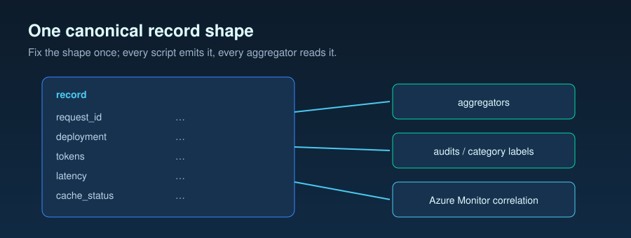

# Observability schema — canonical Provisioned Throughput Unit (PTU) record contract



This document defines the canonical record profiles for individual
requests and aggregate measurement windows that every
provisioned-throughput-aware script in this repository emits. Downstream
aggregators and audits rely on it.

The schema is generated from
`batch_runner/observability/schema.py` and emitted as JSON Schema files
under `schemas/`. The Azure Monitor correlation contract lives in
`batch_runner/observability/azure_monitor_contract.py`.

---

## 1. Purpose

Before Task 028, each measurement script (013, 019, 021, …) defined its
own keyset. Task 020's aggregator had to translate between shapes.
Adding more measurement tasks would multiply that cost. Task 028 fixes
the record profile once: header field names match the Azure OpenAI
response headers documented on Microsoft Learn verbatim, Azure Monitor
metric names match the REST names in Learn's monitoring data reference
verbatim, and every field carries an
``official_spec`` vs ``operational_inference`` tag per Task 029. Two
recorded headers, `x-ms-region` and `x-request-id`, are observed headers
and are tagged ``operational_inference``. The public sources are
listed in §2 and §4.

---

## 2. Per-request schema — `PTURequestRecord`

One record per Azure OpenAI request. Emitted as a JSON Lines row.

### Identity fields (operational inference)

| Field | Type | Notes |
|---|---|---|
| `request_idx` | int | Monotonic index within a measurement run. Repo convention. |
| `wallclock_timestamp_iso` | string (ISO 8601) | UTC. |
| `deployment_name_requested` | string | What the client targeted, before any spillover (automatic routing of overflow requests from a saturated provisioned deployment to a standard deployment). |

### Azure response headers (official spec, except two observed headers)

Header names are case-sensitive lowercase (HTTP/2 style) and match the
Microsoft Learn pages listed below verbatim, except `x-ms-region` and
`x-request-id`, which are observed headers (operational inference). The
JSON Schema attaches a `header_name` annotation on each.

| Field | Type | `header_name` | Source | Notes |
|---|---|---|---|---|
| `response_status_code` | int | — | HTTP status line | |
| `retry_after_ms` | number \| null | `retry-after-ms` | Provisioned 429 page | Contract-reliable on HTTP rate-limit status 429. Coexists with `retry_after_seconds` — both fields, no normalization. |
| `retry_after_seconds` | number \| null | `retry-after` | Provisioned 429 page | Contract-reliable on 429. |
| `x_ms_region` | string \| null | `x-ms-region` | Observed | Observability. **Operational inference:** observed response header; the schema tags it `operational_inference`. |
| `x_request_id` | string \| null | `x-request-id` | Observed | Observability. **Operational inference:** observed response header; the schema tags it `operational_inference`. |
| `x_ms_deployment_name` | string \| null | `x-ms-deployment-name` | Spillover page | Actual server (may differ from requested on spillover). |
| `x_ms_spillover_from_deployment` | string \| null | `x-ms-spillover-from-deployment` | Spillover page | Spillover origin. |
| `x_ms_spillover_error` | string \| null | `x-ms-spillover-error` | Spillover page | The provisioned deployment's status code that triggered spillover (for example 429, 500 or 503). Present on both successful and failed spillovers. |
| `x_ratelimit_remaining_requests` | int \| null | `x-ratelimit-remaining-requests` | Quota page | **Optional on PTU path.** The quota page documents `x-ratelimit-*` with the Standard (TPM/RPM) rate limits and notes that provisioned deployments calculate rate limits differently. Treating these headers as not contract-guaranteed on PTU is this repo's convention (operational inference). The schema flags this with `optional_on_ptu: true`. |

Public sources (Microsoft Learn, checked 2026-11-23):

- **Provisioned 429 page** — "Operate provisioned throughput
  deployments in production": at 100% utilization the service returns
  HTTP 429 with the `retry-after-ms` and `retry-after` headers.
  <https://learn.microsoft.com/en-us/azure/foundry/openai/how-to/provisioned-get-started>
- **Spillover page** — "Manage traffic with spillover for provisioned
  deployments": `x-ms-spillover-from-deployment`,
  `x-ms-deployment-name`, `x-ms-spillover-error`.
  <https://learn.microsoft.com/en-us/azure/foundry/openai/how-to/spillover-traffic-management>
- **Quota page** — "Manage Azure OpenAI in Microsoft Foundry Models
  quota", section "Rate limit response headers".
  <https://learn.microsoft.com/en-us/azure/foundry/openai/how-to/quota>

### OpenAI usage block (official spec)

| Field | Type | Source |
|---|---|---|
| `prompt_tokens` | int | `usage.prompt_tokens` |
| `completion_tokens` | int | `usage.completion_tokens` |
| `cached_tokens` | int | `usage.prompt_tokens_details.cached_tokens` |
| `reasoning_tokens` | int | `usage.completion_tokens_details.reasoning_tokens` |
| `total_tokens` | int | `usage.total_tokens` |

### Request parameters that influence admission (official spec)

| Field | Type | Notes |
|---|---|---|
| `max_output_tokens_sent` | int \| null | The value passed in the request. |
| `prompt_cache_key_used` | string \| null | **Hash, never raw.** See §5. |
| `prompt_cache_retention_sent` | enum: `in_memory` \| `24h` \| null | |
| `reasoning_effort_sent` | enum: `none` \| `low` \| `medium` \| `high` \| `xhigh` \| null | |
| `model_id` | string | The `model` field sent on the request. |

### Latency (operational inference)

| Field | Type | Notes |
|---|---|---|
| `first_token_latency_ms` | number \| null | Client-side. May be null for non-streaming. |
| `total_latency_ms` | number | Client-side wall time. |

---

## 3. Per-cell summary schema — `PTUCellSummary`

One record per measurement cell window (see Task 013 cell taxonomy).

| Field | Type | Category | Notes |
|---|---|---|---|
| `cell_id` | string | inference | Repo cell id. |
| `cell_label` | string | inference | Human-readable. |
| `window_start_iso` | string | inference | UTC. |
| `window_end_iso` | string | inference | UTC. |
| `deployment_name` | string | inference | Deployment under measurement. |
| `request_count` | int | inference | Number of `PTURequestRecord` rows in the window. |
| `real_429_count` | int | inference | Rows with `response_status_code == 429`. |
| `mean_cached_fraction` | number | inference | `cached_tokens / prompt_tokens`, averaged. |
| `p50_ttft_ms` | number | inference | Median / 50th-percentile time-to-first-token (TTFT), computed from `first_token_latency_ms`. |
| `p95_ttft_ms` | number | inference | 95th-percentile TTFT. |
| `p99_ttft_ms` | number | inference | |
| `mean_retry_after_ms_on_429` | number \| null | inference | Null if no 429s in the window. |
| `azure_monitor_metrics_to_query` | array of string | **official_spec** | Frozen list of six Azure Monitor metric REST names. The names are official (listed on Microsoft Learn), so the field is tagged `official_spec`; the selection of six and the same-window rule are repo convention (operational inference) — see §4. |

---

## 4. Azure Monitor correlation contract

`batch_runner.observability.azure_monitor_contract` exposes:

```python
AZURE_MONITOR_PTU_METRICS = (
    "AzureOpenAIProvisionedManagedUtilizationV2",
    "AzureOpenAIRequests",
    "AzureOpenAITimeToResponse",
    "AzureOpenAITTLTInMS",
    "AzureOpenAIContextTokensCacheMatchRate",
    "ActiveTokens",
)

def azure_monitor_correlation_window(record, *, pad_seconds=60) -> (start_iso, end_iso): ...
```

The six names are the REST names listed in Microsoft Learn's
"Monitoring data reference for Azure OpenAI"
(<https://learn.microsoft.com/en-us/azure/foundry/openai/monitor-openai-reference>,
checked 2026-11-23). Learn lists the metrics but does not say which
ones to query together; the selection and the same-window rule below
are a convention used here (operational inference).

**All six metrics MUST be queried on the same time window** when
interpreting a `PTURequestRecord`. The window is derived from the
record's `wallclock_timestamp_iso` with a symmetric pad (default 60 s)
on each side — wide enough to land inside Azure Monitor's 1-minute
aggregate bucket regardless of small clock skew.

The helper is **pure**: no Azure software development kit (SDK) import, no network call, no
credential read. Operators (or downstream offline tools) perform the
actual query using the returned window.

`AzureOpenAIRequests` is queried with the `StatusCode` and
`IsSpillover` dimensions; the same Learn page lists both among that
metric's dimensions.

---

## 5. What MUST NOT be in the schema

The schema deliberately omits the following. Tests in
`batch-runner/tests/test_observability_schema.py` enforce these.

- **Authentication.** No `api_key`, no `Authorization` header field.
- **Request body content.** No `messages`, no `system_prompt`, no
  `prompt`, no `content`, no `request_body`.
- **Environment variable values.** No fields that mirror env-var values.
- **Raw `prompt_cache_key`.** Microsoft Learn ("Prompt caching with
  Azure OpenAI in Microsoft Foundry Models",
  <https://learn.microsoft.com/en-us/azure/foundry/openai/how-to/prompt-caching>,
  checked 2026-11-23) describes `prompt_cache_key` as a parameter that
  helps route related requests; the raw value can carry
  tenant or customer identifiers. The schema stores only a stable
  **hash** via `hash_cache_key(raw)`, which returns a 16-character
  lowercase hex digest (truncated SHA-256). Enforcement is field-level:
  `PTURequestRecord.__post_init__` normalizes any non-digest string
  through `hash_cache_key`, and the emitted JSON Schema constrains
  the field to `^[0-9a-f]{16}$` (length 16). Tests in
  `batch-runner/tests/test_observability_schema.py` cover raw-input
  normalization, already-valid-digest preservation, and the `None`
  case.

---

## 6. Migration path

Existing measurement scripts (013, 019, 021) MAY adopt the canonical
schema in a follow-up minor revision; this task ships schema, tests,
and doc only, with no breaking change to existing record shapes.
Until adoption, Task 020's aggregator translates older shapes using
the mapping below.

### Mapping table (older record → canonical field)

| Older record key | Originating task | Canonical field |
|---|---|---|
| `endpoint_hit` | Task 013 | `x_ms_deployment_name` |
| `deployment_requested` | Task 013 | `deployment_name_requested` |
| `spillover_origin` | Task 013 | `x_ms_spillover_from_deployment` |
| `spillover_err` | Task 013 | `x_ms_spillover_error` |
| `region` | Task 013 | `x_ms_region` |
| `request_id` | Task 013 / 021 | `x_request_id` |
| `429_observed` | Task 019 | `response_status_code == 429` |
| `retry_after_ms` | Task 019 / 020 | `retry_after_ms` (unchanged) |
| `retry_after` | Task 019 | `retry_after_seconds` |
| `ratelimit_remaining` | Task 019 | `x_ratelimit_remaining_requests` |
| `usage.prompt_tokens` | Task 013+ | `prompt_tokens` |
| `usage.completion_tokens` | Task 013+ | `completion_tokens` |
| `usage.prompt_tokens_details.cached_tokens` | Task 023 | `cached_tokens` |
| `usage.completion_tokens_details.reasoning_tokens` | Task 023 | `reasoning_tokens` |
| `usage.total_tokens` | Task 013+ | `total_tokens` |
| `max_output_tokens` | Task 019 | `max_output_tokens_sent` |
| `cache_key` (raw) | Task 024 | `prompt_cache_key_used` (must be hashed) |
| `cache_retention` | Task 024 | `prompt_cache_retention_sent` |
| `reasoning_effort` | Task 023 | `reasoning_effort_sent` |
| `model` | Task 013+ | `model_id` |
| `ttft_ms` | Task 013+ | `first_token_latency_ms` |
| `latency_ms` / `wall_ms` | Task 013+ | `total_latency_ms` |

For aggregator output, the old per-window summary key `n_429` maps to
`real_429_count`; `p50_latency_ms` (TTFT) maps to `p50_ttft_ms`, etc.

---

## 7. Compliance with Task 029

Every field in both records carries a `category` tag in the emitted
JSON Schema:

- `official_spec` — name and semantics come from a public Microsoft
  Learn page (the header and metric sources in §2 and §4) or the
  OpenAI `usage` block.
- `operational_inference` — repo convention (e.g. `cell_id`,
  `request_idx`, latency measurements, and the observed `x_ms_region`
  and `x_request_id` headers).

The schema files therefore satisfy Task 029's per-field labeling
requirement and serve as the worked example for future schemas.

---

## 8. Privacy & secrets — enforcement summary

- `prompt_cache_key_used` is a 16-hex-char SHA-256 prefix; raw key
  never written.
- No auth fields exist (`api_key`, `Authorization`).
- No request body content fields exist (`messages`, `system_prompt`,
  `prompt`, `content`, `request_body`).
- No environment variable values are echoed.
- No Azure / OpenAI SDK imports in the observability package; no
  network calls; no credential reads. The package is import-safe in
  any environment.
